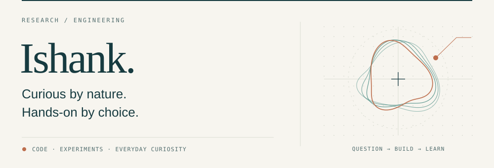

<picture>
  <source media="(prefers-color-scheme: dark)" srcset="banner-dark.svg">
  <source media="(prefers-color-scheme: light)" srcset="banner-light.svg">
  
</picture>

### Hello, I'm Ishank.

I build practical tools and explore the ideas behind them. My work ranges from drone telemetry and desktop assistants to interactive worlds — with a growing interest in quantum computing and security.

I like a good question, a small working prototype, and evidence that tells me what to improve next.

### Selected work

| Project | What I'm exploring |
| :--- | :--- |
| **[Drone Flight Safety Monitor](https://github.com/ishankpandey7/drone-flight-safety-monitor)** RESEARCH · PYTHON · TELEMETRY | How early can telemetry reveal a failing drone? A study of anomaly detection, warning time, and evaluation on flight logs. [Explore the demo](https://drone-flight-safety-monitor.vercel.app) |
| **[MyVerse](https://github.com/ishankpandey7/myverse)** CREATIVE SOFTWARE · TYPESCRIPT · THREE.JS | A personal world where ideas become missions and progress brings an island to life. An exploration of interaction, 3D environments, and local persistence. |
| **[JARVIS](https://github.com/ishankpandey7/jarvis-voice-assistant)** TOOLS · PYTHON · AUTOMATION | A Windows voice assistant for everyday work: opening apps, finding files, and setting reminders. Built around useful actions and explicit user control. |

### On my workbench

**Machine learning** &nbsp; / &nbsp; **Quantum computing** &nbsp; / &nbsp; **Security** &nbsp; / &nbsp; **Interfaces worth using**

Working with Python, TypeScript, React, and Three.js. Learning through experiments, building in small steps, and documenting what holds up.

---

[Explore my repositories](https://github.com/ishankpandey7?tab=repositories) &nbsp; · &nbsp; Questions and thoughtful feedback are welcome in the relevant project's issues.
