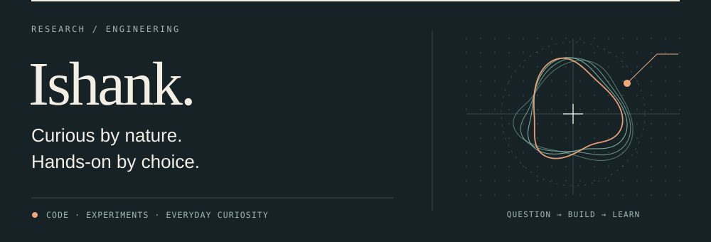

<a href="https://ishankpandey7.github.io/ishankpandey7/">
  <picture>
    <source media="(prefers-color-scheme: dark)" srcset="banner-dark.svg">
    <source media="(prefers-color-scheme: light)" srcset="banner-light.svg">
    
  </picture>
</a>

  <a href="https://ishankpandey7.github.io/ishankpandey7/"><b>🪐 Explore my interactive 3D universe →</b></a>

Hi, I'm Ishank. I build practical tools, run experiments, and follow questions across machine learning, quantum computing and security.

The link above opens a small 3D world: walk between the observatory, workshop, flight deck and idea garden to find my projects.

### Projects

| | Project | What it is |
|---|---|---|
| 🛩️ | [Drone Flight Safety Monitor](https://github.com/ishankpandey7/drone-flight-safety-monitor) · [demo](https://drone-flight-safety-monitor.vercel.app) | Spotting early signs of motor, battery and sensor problems in flight telemetry |
| 🎙️ | [JARVIS](https://github.com/ishankpandey7/jarvis-voice-assistant) | A Python voice assistant for everyday tasks on a Windows laptop |
| 🌱 | [MyVerse](https://github.com/ishankpandey7/myverse) | A personal 3D world where saved ideas become missions |

More: [Idea Refinery](https://github.com/ishankpandey7/idea-refinary) · [Marrow](https://github.com/ishankpandey7/marrow) · [all repositories](https://github.com/ishankpandey7?tab=repositories)

The 3D site's source lives in <a href="docs/">docs/</a>.
